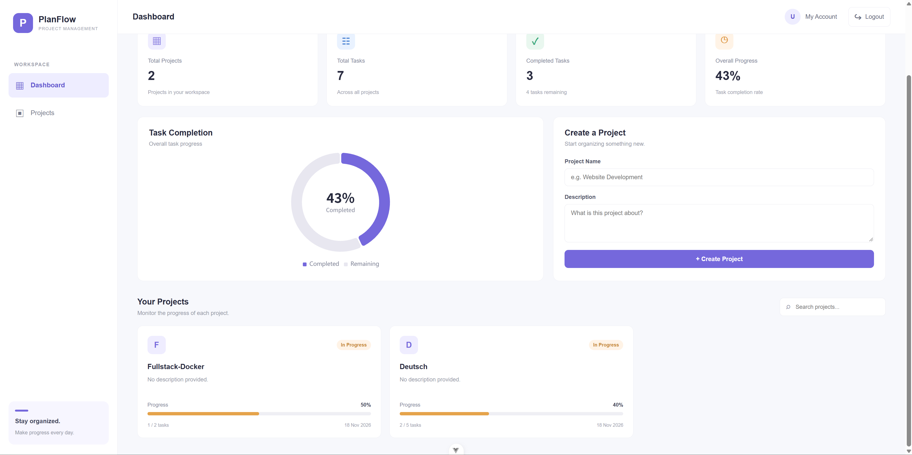
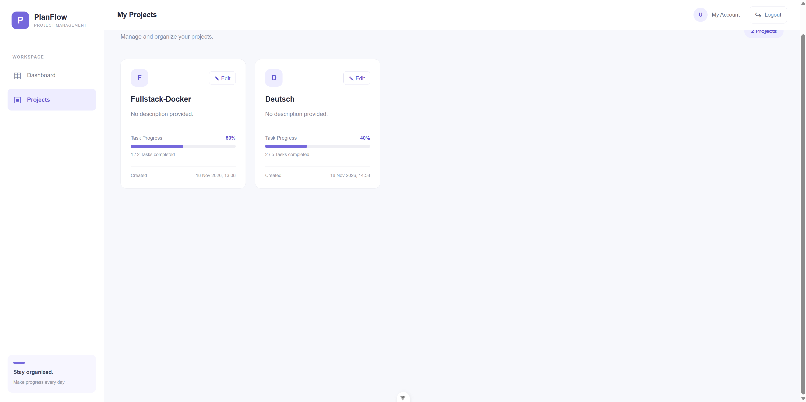
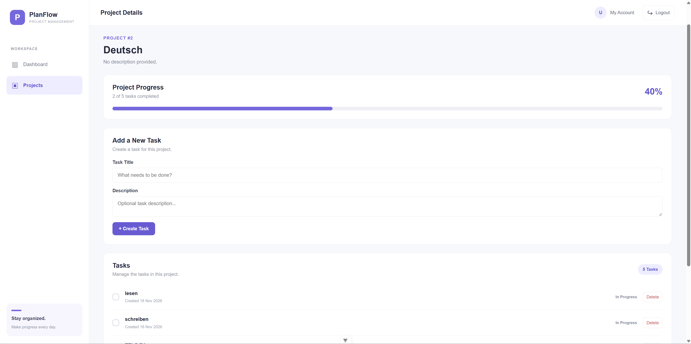
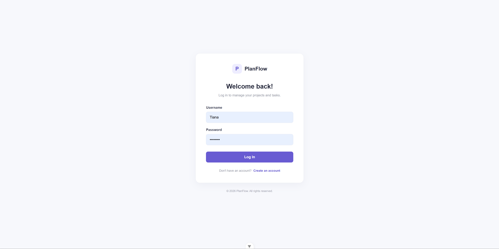

# PlanFlow

**A Full-Stack Project and Task Management Application**

PlanFlow is a full-stack web application that helps users organize projects, manage tasks, and track project progress through an intuitive and user-friendly interface.

Built with **Vue 3, TypeScript, Django REST Framework, and PostgreSQL**, PlanFlow provides a complete solution for project and task management, featuring JWT-based authentication, project-specific task organization, and automatic progress tracking.

## Key Features

- **User Authentication:** Secure user registration and login using JWT.
- **Project Management:** Create, view, update, and delete projects.
- **Task Management:** Create, update, complete, and delete tasks.
- **Category Organization:** Organize tasks into project-specific categories.
- **Progress Tracking:** Automatically calculate project completion based on completed tasks.
- **Data Isolation:** Ensure users can only access their own projects and tasks.

## Tech Stack

| Category | Technologies |
|---|---|
| Frontend | Vue 3, TypeScript, HTML, CSS |
| State Management | Pinia |
| Backend | Python, Django, Django REST Framework |
| Database | PostgreSQL |
| Authentication | JWT, SimpleJWT |
| API Communication | REST API, Axios |
| Data Visualization | Apache ECharts |
| Web Server | Nginx, Gunicorn |
| Containerization | Docker, Docker Compose |
| Testing | Pytest, pytest-django |

## Screenshots

### Dashboard

### Project Overview

### Project Details

### Login

## Architecture

PlanFlow follows a client-server architecture consisting of three main components:

- **Frontend:** A Vue 3 and TypeScript application served by Nginx.
- **Backend:** A Django REST Framework application running with Gunicorn, providing RESTful APIs and JWT-based authentication.
- **Database:** PostgreSQL for persistent data storage.

Nginx serves the frontend application and acts as a reverse proxy, forwarding API requests to the backend.

All services are containerized and orchestrated using Docker Compose.

For more details, see the [System Architecture](docs/architecture.md).
