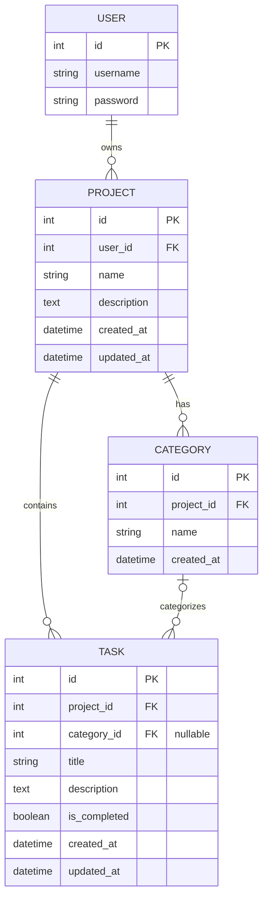

# Database Entity Relationship Diagram

PlanFlow uses PostgreSQL as its relational database.

## ER Diagram

## Relationships

- One user can own multiple projects.
- One project can contain multiple tasks.
- One project can have multiple categories.
- A task belongs to one project.
- A task can optionally belong to one category.
- Each category belongs to one project.

## Referential Integrity

- Deleting a project cascades deletion to its associated tasks and categories.
- Deleting a category sets the associated tasks' category reference to `NULL`.
- Tasks must belong to a project.
